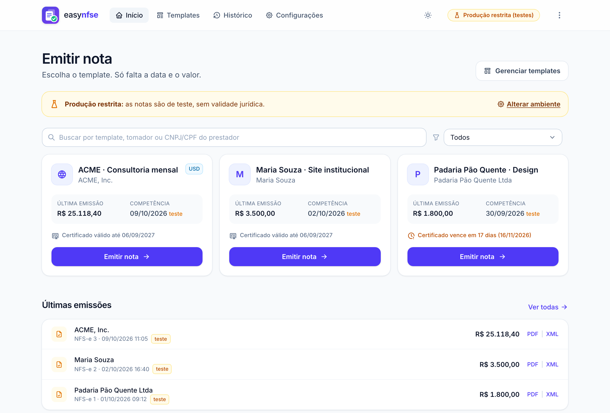

<p align="center"></p>

# easy-nfse

Aplicativo local para emitir NFS-e do **padrão nacional** (Sefin Nacional / [nfse.gov.br](https://www.nfse.gov.br/))
a partir de uma nota já emitida.

1. Arraste o **PDF** (DANFSe ou impressão do Emissor Nacional) ou o **XML** de uma nota anterior.
2. O app cria um **template** com serviço e tributação, ligado aos cadastros do prestador e do tomador
   (criados sozinhos na importação). Revise e salve.
3. A cada nova nota, informe apenas a **data de competência** e o **valor**, revise e emita.

<picture>
  <source media="(prefers-color-scheme: dark)" srcset="docs/screenshots/inicio-escuro.png">
  <source media="(prefers-color-scheme: light)" srcset="docs/screenshots/inicio-claro.png">
  
</picture>

<sub>Tela inicial em uma versão de teste, com dados fictícios: cada template mostra o certificado do seu prestador e avisa
quando ele está perto de vencer. A imagem acompanha o tema (claro ou escuro) do GitHub.</sub>

## Funcionalidades

- Emissão direta pela **API oficial da Sefin Nacional**, com assinatura digital e autenticação feitas com o seu
  certificado A1, sem intermediários.
- **Cadastros de prestadores e tomadores**, compartilhados entre os templates: corrija um endereço uma vez, filtre
  os templates por prestador ou tomador e, na hora de emitir, troque o prestador ou o tomador só para aquela nota.
- **Vários certificados A1**, um por prestador: cada prestador usa automaticamente o certificado do seu CNPJ/CPF
  (ou um escolhido no cadastro), com aviso de validade e numeração da DPS por CNPJ. Para renovar, basta adicionar o novo.
- Importação de notas anteriores em PDF ou XML (ou pela chave de acesso, se houver certificado configurado).
- **Tomador do exterior e exportação de serviço**, com conversão do valor em moeda estrangeira pela PTAX.
- Geração do **PDF da nota (DANFSe v2.0)** e histórico das emissões, com download do PDF e do XML.
- Numeração da DPS automática e protegida contra notas duplicadas.
- **Atualização automática** do app instalado: baixa a versão nova sozinho, confere a integridade e instala com um
  clique (ou ao abrir o app). As notas de cada versão ficam no menu ⋮.
- Tema claro e escuro.

## Requisitos

- macOS, Linux ou Windows com o [uv](https://docs.astral.sh/uv/) instalado (ele baixa o Python 3.13, se necessário).
- **Certificado digital A1** (arquivo `.pfx`/`.p12` ICP-Brasil) do prestador. Certificados A3 (token ou cartão)
  ainda não são suportados.
- Município do prestador aderente à NFS-e de padrão nacional.
- Conexão com a internet para emitir notas.

## Aplicativo para macOS e Windows

Baixe a versão mais recente em [Releases](https://github.com/LukastBorges/easy-nfse/releases): o arquivo
`.dmg` para macOS (Apple Silicon) ou o `.zip` para Windows. O app abre em uma janela própria; não é preciso instalar
Python nem usar o terminal.

Os executáveis ainda **não são assinados** pela Apple nem pela Microsoft, então o sistema avisa na primeira abertura:

- **macOS:** abra o app, feche o aviso e vá em *Ajustes do Sistema → Privacidade e Segurança → Abrir Mesmo Assim*.
- **Windows:** na tela azul do SmartScreen, clique em *Mais informações → Executar assim mesmo*.

No app, os dados ficam na pasta do usuário: `~/Library/Application Support/easy-nfse` (macOS) ou
`%APPDATA%\easy-nfse` (Windows). Para levar os dados de uma instalação a partir do código-fonte, copie o conteúdo
da pasta `data/` para essa pasta com o app fechado.

## Instalação a partir do código-fonte

```bash
git clone https://github.com/LukastBorges/easy-nfse.git
cd easy-nfse
uv run easy-nfse          # instala as dependências na primeira vez e abre http://127.0.0.1:8000
```

Para usar a janela própria em vez do navegador: `uv run --group desktop easy-nfse-desktop`.

## Primeiros passos

1. Em **Configurações**, envie o certificado A1 e a senha dele. Use **Testar conexão com a Sefin** para conferir.
2. Mantenha o ambiente em **Produção restrita** enquanto testa: as notas emitidas nele não têm validade jurídica.
3. Em **Templates**, importe uma nota anterior e revise os dados.
4. No **Início**, escolha o template, informe a data e o valor, revise e emita.
5. Quando estiver tudo certo, mude o ambiente para **Produção** em *Configurações*.

## Dados e segurança

- Tudo fica no seu computador: na pasta `./data` ao rodar pelo código-fonte, na pasta do usuário no app para macOS
  e Windows, ou na indicada por `$EASY_NFSE_DATA`. Ela guarda certificado, senha, templates, numeração e XMLs das
  notas emitidas. No macOS e no Linux, os arquivos podem ser lidos apenas pelo seu
  usuário.
- A pasta `data/` está no `.gitignore` e **nunca deve ser versionada nem compartilhada**.
- O servidor escuta apenas em `127.0.0.1`. Não o exponha na rede, pois ele guarda o seu certificado.
- Se preferir não gravar a senha do certificado em disco, defina a variável de ambiente `EASY_NFSE_CERT_SENHA`.

## Configuração

- **Certificado A1**: em *Configurações*. O card fica verde quando o certificado é válido e âmbar quando está expirado.
- **Ambiente**: o padrão é *Produção restrita* (testes, sem validade jurídica). Troque para *Produção* quando estiver
  tudo certo.
- **Série da DPS**: o padrão é `1`, dentro da faixa reservada a aplicativos próprios (1 a 49999). O Emissor Web usa
  outra faixa, então as numerações não colidem.
- **Numeração da DPS**: avança automaticamente a cada nota aceita pela Sefin. Só é preciso ajustá-la se o mesmo CNPJ
  já tiver usado a mesma série em outro sistema.

| Variável de ambiente | Uso |
|---|---|
| `EASY_NFSE_DATA` | Pasta de dados (padrão: `./data` pelo código-fonte; pasta do usuário no app) |
| `EASY_NFSE_CERT_SENHA` | Senha do certificado, em vez de gravá-la em disco |
| `EASY_NFSE_HOST` / `EASY_NFSE_PORT` | Endereço e porta do servidor (padrão: `127.0.0.1:8000`; no app, porta `47318`) |
| `EASY_NFSE_NO_BROWSER` | Não abre o navegador nem a janela ao iniciar (só o servidor) |

## Tomador do exterior e exportação

Escolha **Exterior (NIF)** no tipo de documento do tomador. O app pede o endereço no exterior, o código NBS
(obrigatório, E0318) e os dados de comércio exterior (moeda, modo de prestação etc.). Com a tributação
**Exportação de serviço** e a prestação no Brasil, o país do resultado é obrigatório (E0590); por padrão, ele é o
país do tomador.

A cada emissão, você informa o valor na moeda do contrato, e o botão **PTAX** sugere o valor em reais pela cotação de
venda do Banco Central. Confirme com o seu contador qual taxa usar.

## Como funciona

| Etapa | Detalhes |
|---|---|
| Importação de PDF | Lê a chave de acesso e os campos do DANFSe (v1.0/v2.0) ou da impressão da Consulta Pública. Os códigos IBGE vêm da chave e da API do IBGE. Se houver certificado, baixa o **XML oficial** pela chave (`GET /nfse/{chave}`), que é mais fiel. |
| Importação de XML | Copia exatamente a DPS original (`infDPS`). |
| DPS | Leiaute v1.01, validada contra o XSD oficial (`src/easy_nfse/xsd`). |
| Assinatura | XMLDSig *enveloped*, RSA-SHA256, C14N 1.0, sem o prefixo `ds:`. |
| Envio | `POST /nfse` com mTLS e o corpo `{"dpsXmlGZipB64": ...}`. |
| PDF (DANFSe) | Gerado pelo app no layout **DANFSe v2.0** (NT 008/2026), porque a API oficial de DANFSe foi suspensa em 03/08/2026. Fica salvo em `data/emissoes/` e disponível no resultado da emissão e no histórico. O histórico também gera o PDF de qualquer XML de NFS-e. |
| Numeração | Só avança quando a Sefin aceita a nota. Reenviar com o mesmo número é seguro: a Sefin recusa a duplicata (E0014), e o app mostra a nota existente. |

## Limitações conhecidas

- Não há suporte a intermediário, deduções/reduções, tributação federal nem ao grupo IBS/CBS.
- Apenas certificado A1 (arquivo); certificados A3 ainda não são suportados.
- Executáveis sem assinatura de código (Apple/Microsoft) e apenas para macOS Apple Silicon e Windows x64.
- A leitura de PDF é heurística: revise sempre o template importado. Notas dos sistemas municipais antigos
  (anteriores ao padrão nacional) não são reconhecidas.
- Na cópia local do XSD, os caracteres `^` e `$` foram removidos dos padrões (*patterns*), porque em XSD eles são
  literais (falha do esquema oficial).

## Testes

```bash
uv run pytest                                   # testes unitários (assinatura verificada com libxmlsec1)
EASY_NFSE_SAMPLES=pasta/com/pdfs uv run pytest  # inclui a leitura de PDFs reais (não versionados)
```

## Versões e executáveis

As versões seguem o padrão **Conventional Commits** e são geradas pelo
[release-please](https://github.com/googleapis/release-please): a cada push na `main`, ele mantém um PR de release
com a próxima versão e o `CHANGELOG.md`. Ao fazer merge desse PR, a tag e a release são criadas, e o GitHub Actions
gera, testa e anexa os executáveis de macOS e Windows. Também é possível gerar os executáveis sem criar release
(*Actions → release → Run workflow*); eles ficam disponíveis como artefatos da execução.

Um workflow semanal (*monitor-nfse*) compara a documentação técnica oficial da NFS-e com o retrato salvo em
`.github/nfse-monitor/estado.json` e abre uma issue quando algo muda (novos esquemas XSD, regras, notas técnicas ou
endereços das APIs), indicando o que revisar no código.

Para gerar localmente (no sistema de destino):

```bash
uv run --group desktop --group build pyinstaller packaging/easy-nfse.spec --noconfirm
# macOS: dist/easy-nfse.app · Windows: dist/easy-nfse/easy-nfse.exe
```

## Desenvolvimento

As instruções para agentes de código e as convenções do projeto, incluindo o padrão **Conventional Commits**,
estão em [AGENTS.md](AGENTS.md).

## Aviso

Este projeto não tem vínculo com a Receita Federal, a Sefin Nacional nem com prefeituras. A responsabilidade pelas
notas emitidas e pelas informações fiscais é de quem as emite; em caso de dúvida, consulte o seu contador.
