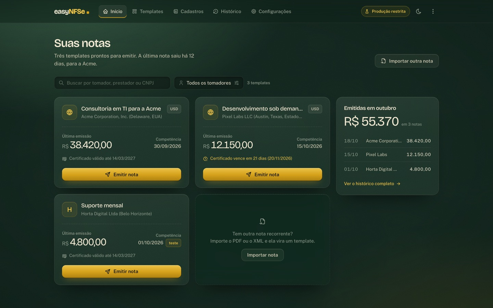
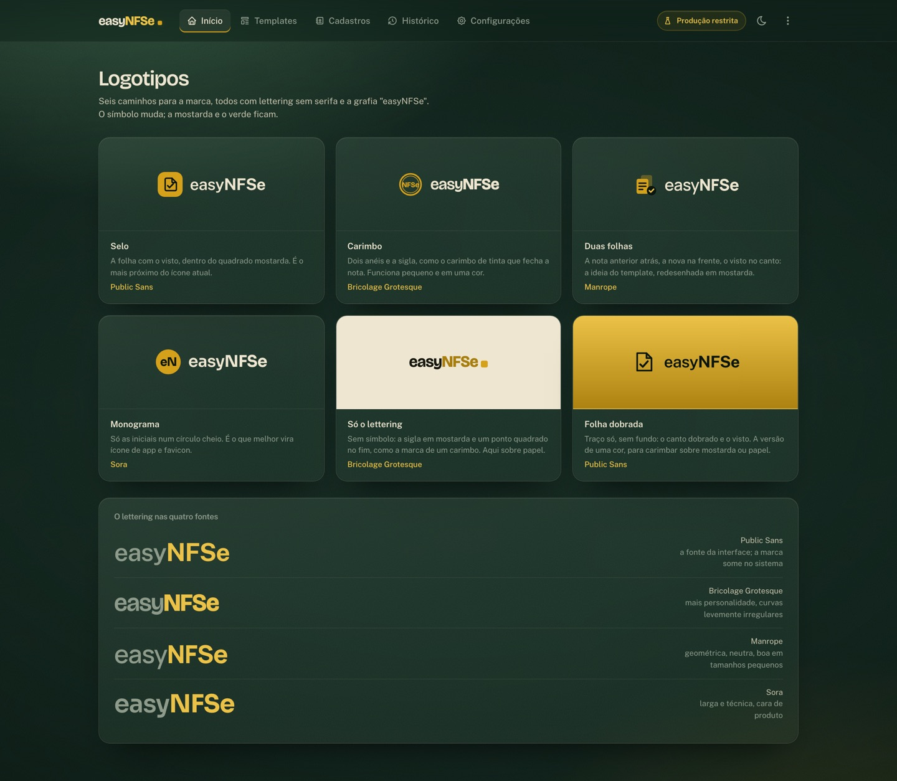

# Identidade visual: Mata, mostarda e papel

Especificação da nova identidade do easyNFSe. Vale para toda tela nova ou alterada. O plano de implantação está em
[plano.md](plano.md); as telas de referência, em [telas/](telas/), e os fontes que as geram, em [conceitos/](conceitos/).

## A ideia

A mesa de um escritório à noite: madeira escura sob a luminária, folhas de papel, um carimbo de tinta mostarda.
Os painéis são vidro fosco apoiado nessa mesa. A nota fiscal que está sendo emitida é a única folha de papel claro.

Três regras sustentam o conceito:

- **Nada é cor chapada.** O fundo tem luz, vinheta e grão; o vidro tem brilho na borda e grão por cima.
- **A mostarda é reservada para ação e para a marca.** Um botão mostarda por área de decisão; o resto é vidro.
- **Movimento responde ao usuário.** Uma única entrada orquestrada por página; o resto acontece no hover, no foco e no clique.



## Cores

O app é escuro por padrão. Os verdes empilhados fazem o papel do preto; não use `#000` nem cinzas neutros.

| Token | Valor | Uso |
|---|---|---|
| `mata-0` | `#0A150F` | Fundo mais profundo, sombra de campos, tinta sobre mostarda |
| `mata-1` | `#10211A` | Fundo da página |
| `mata-2` | `#172D22` | Superfícies sólidas raras (opções de select) |
| `mata-3` | `#1F3C2C` | Reservado (estados pressionados) |
| `musgo` | `#2A4E39` | Trilho de chave desligada, luz do fundo |
| `mostarda` | `#D5A11A` | Ação principal, marca, foco |
| `mostarda-clara` | `#EBC247` | Topo do gradiente do botão, textos de destaque, links |
| `mostarda-escura` | `#AE8210` | Base do gradiente do botão, mostarda sobre papel claro |
| `papel` | `#EEE6D0` | Texto principal, a folha da emissão |
| `papel-2` | `#C8C4AD` | Texto secundário |
| `erva` | `#8E9B8B` | Rótulos e texto apagado |
| `erva-escura` | `#5E6E60` | Placeholders, ícones de campo |
| `tinta` | `#15170F` | Texto sobre papel e sobre mostarda |
| `barro` | `#CF6F5B` | Erro, expirado, produção (perigo) |
| `folha` | `#7FB889` | Sucesso: autorizada, certificado válido |

Estados usam cor e forma ao mesmo tempo: selo (`pill`) com borda e fundo translúcido da mesma cor, nunca só o texto
colorido. Teste é mostarda, autorizada é folha, rejeitada e expirada são barro.

## Tipografia

| Papel | Fonte | Detalhes |
|---|---|---|
| Títulos, nomes de templates e cadastros, valores em reais, marca | **Bricolage Grotesque** (variável, `opsz` 12–96) | Peso 600 nos títulos, `letter-spacing` −0,02 a −0,03em; números com `tabular-nums lining-nums`, exceto dentro de campos (proporcionais) |
| Interface: rótulos, campos, botões, tabelas, textos | **Public Sans** (variável) | 14 px de base; rótulos 12–12,5 px na cor `erva` |

Escala: título da página 34 px (28 px no celular), título de seção 19–20 px, título de card 16–17 px, valor em
destaque 26–40 px. Sem caixa alta em rótulos, sem itálico de ênfase, sem fonte monoespaçada para dados (só para
caminhos de arquivo).

## Marca

`easyNFSe` só em lettering, sem símbolo: "easy" em `papel` peso 700, "NFSe" em `mostarda-clara` peso 800, seguido de um
ponto quadrado mostarda (7 px, raio 2 px, leve brilho). Bricolage Grotesque, 21 px no cabeçalho. A grafia é sempre
`easyNFSe`. O ícone de app e o favicon ainda precisam de um símbolo derivado dessa marca (ver o plano).



## Materiais

**Fundo (a mesa).** Cor `mata-1` com três camadas fixas: luz verde vinda do canto superior esquerdo
(`rgba(74,124,90,.55)`), um reflexo mostarda fraco no canto inferior direito e vinheta escura nas bordas. Por cima,
grão fino (`feTurbulence fractalNoise`, frequência 0,9, `soft-light`, opacidade 0,24) e fibras largas e alongadas
(frequência 0,006 × 0,012, `overlay`). As texturas são SVG em `data:` URI, sem imagens externas.

**Vidro fosco.** Gradiente de `papel` de 7,5 % a 2 % de opacidade, `backdrop-filter: blur(22px) saturate(1.3)`, borda
de 1 px em `papel` a 11 %, brilho interno de 1 px no topo, sombra longa e difusa abaixo, raio 18 px. O grão é
repetido por cima do vidro, porque o desfoque apaga a textura que está atrás.

**Papel (a nota).** Só a folha da emissão: `#EEE7D3` com grão em `multiply`, luz diagonal de cima, raio 6 px, levemente
girada (−0,35°). Campos sobre o papel ficam claros com borda de tinta a 18 %. O carimbo do ambiente ("Produção
restrita, sem valor jurídico") é um círculo duplo em mostarda escura girado 8°, em `multiply`.

**Campos.** Fundo `mata-0` a 45 % com sombra interna; foco com borda mostarda a 60 % e halo de 3 px.

## Componentes

| Componente | Forma |
|---|---|
| Botão principal | Gradiente `mostarda-clara` → `mostarda` → `mostarda-escura`, texto `tinta` 600, raio 11 px, brilho interno no topo, sombra mostarda difusa |
| Botão secundário | Vidro: `papel` a 6 %, borda a 13 %, texto `papel-2` |
| Botão sobre papel | Transparente, borda de tinta a 22 % |
| Card / painel | Vidro fosco; hover acende a borda (abaixo) |
| Card de template na Início | Todos do mesmo tamanho: colunas e linhas iguais na grade, botão sempre no pé. Título, tomador e estado do certificado em uma linha, com reticências e o texto completo no `title` |
| Marca-texto | Faixa mostarda em `multiply` sobre o papel, desenhada da esquerda para a direita; usada só na boas-vindas para mostrar o que vira template |
| Linha de lista | Sem card próprio: linhas dentro de um vidro, divisória de 1 px a 7 %, fundo a 3 % no hover |
| Selo (`pill`) | Raio 6 px, 11 px peso 600, fundo e borda translúcidos da cor do estado |
| Aviso dentro de card | Fundo mostarda a 8 %, borda a 25 %, ícone e texto curto dizendo o que fazer |
| Área de soltar arquivo | Borda tracejada mostarda a 35–38 %, fundo mostarda a 4–7 %; uma folha de papel que se ergue no hover |
| Opção de ambiente | Cartão de rádio; selecionado com borda e ponto mostarda; Produção usa ícone de alerta em `barro` |
| Chave liga/desliga | Trilho `musgo` desligado, gradiente mostarda ligado, bolinha `papel` |
| Validade de certificado | Régua de 6 px: `folha` válido, mostarda vencendo, `barro` expirado (card a 72 % de opacidade) |
| Abas | Fichas de arquivo: a ativa ganha fundo de vidro e um fio mostarda de 2 px no topo |
| Filtros rápidos | Chips arredondados; o ativo é `papel` cheio com texto `tinta`; contagem em mostarda |

Bordas tracejadas significam "solte algo aqui" ou "separação dentro do mesmo objeto"; não use como decoração.

## Movimento

Curva única: `cubic-bezier(.22, .72, .18, 1)`.

- **Entrada da página:** os blocos "pousam na mesa", de 14 px abaixo e transparentes até o lugar, 700 ms, com 80 ms
  entre um bloco e o próximo. Só na carga da página, não em trocas por htmx. A animação usa a propriedade
  `translate`, não `transform`, para não desfazer a rotação das folhas de papel.
- **Menu do cabeçalho:** a página atual é marcada por um único realce (vidro com fio mostarda embaixo) que desliza
  até o item clicado em 420 ms e só então troca de página. Quando a página muda por outro caminho (link, card,
  voltar), o realce nasce no item da página anterior e desliza até o atual; o item anterior fica em
  `sessionStorage`. Sem JavaScript, o item ativo tem o próprio fundo.
- **Hover em card:** sobe 2 px e um anel de luz acende só na borda (gradiente cônico mascarado, mais forte no canto
  superior esquerdo, com um toque de mostarda); o miolo não muda.
- **Botão mostarda:** um brilho atravessa o botão em 700 ms no hover; pressionado, afunda 1 px como um carimbo.
- **Foco:** halo mostarda visível em todo controle (teclado).
- `prefers-reduced-motion: reduce` desliga a entrada, o brilho e o anel.

## Texto

Mantém as regras do `AGENTS.md`: português, frases curtas, mensagens dizem o que fazer e citam o código da Sefin.
Cada tela abre com um título e uma frase que diz o que há nela. Um botão diz o que acontece ("Assinar e emitir",
"Completar cadastro", "Ajustar numeração").

## O que não fazer

- Cores do Tailwind padrão (`slate`, `indigo`, `emerald`…) em telas novas.
- Mostarda em mais de um botão por área, ou como cor de fundo de seções.
- Cards com a mesma sombra empilhados sem hierarquia; listas longas viram linhas dentro de um vidro.
- Numeração decorativa (01, 02, 03) quando o conteúdo não é uma sequência.
- Animar entrada de cada card a cada troca htmx.

## Telas de referência

| Tela | Imagem |
|---|---|
| Boas-vindas (sem templates) | [08-boas-vindas-1440.jpg](telas/08-boas-vindas-1440.jpg), [celular](telas/08-boas-vindas-390.jpg) |
| Início | [01-inicio-1440.jpg](telas/01-inicio-1440.jpg), [celular](telas/01-inicio-390.jpg) |
| Templates | [05-templates-1440.jpg](telas/05-templates-1440.jpg), [celular](telas/05-templates-390.jpg) |
| Cadastros | [06-cadastros-1440.jpg](telas/06-cadastros-1440.jpg) |
| Emissão | [02-emissao-1440.jpg](telas/02-emissao-1440.jpg) |
| Histórico | [03-historico-1440.jpg](telas/03-historico-1440.jpg) |
| Configurações | [07-configuracoes-1440.jpg](telas/07-configuracoes-1440.jpg) |
| Prancha de identidade | [00-identidade-1440.jpg](telas/00-identidade-1440.jpg) |

Os dados das telas são fictícios. Para regerar as imagens:

```bash
uv run --with playwright python docs/design/conceitos/renderizar.py --png   # saída em build/conceitos/
```

Os conceitos são HTML e CSS puros, sem Tailwind: servem de referência visual e de valores, não para copiar
marcação. Na implementação, os valores viram tokens e `@utility` do Tailwind (ver o plano).
